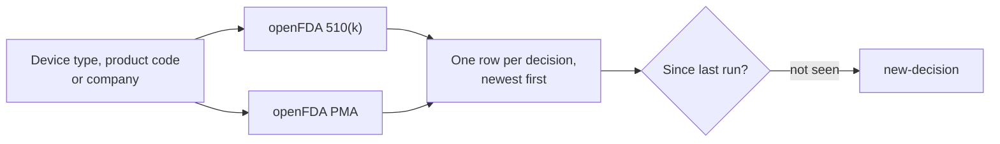

# Medical Device Clearance Tracker: Every New FDA 510(k) and PMA Decision

[](https://apify.com/arched_friend/medical-device-clearance-tracker)

**[Run it on the Apify Store](https://apify.com/arched_friend/medical-device-clearance-tracker)**. Nothing to install: try it in your browser, schedule it, or call it as an API.

Track FDA 510(k) clearances and PMA approvals by device type, product code or company. You get the device, the applicant, the device class, the decision and its date, how long FDA took to review it, and a link to the official FDA record, newest first. Schedule it, and each run returns only the decisions published since the last one.

Built for medtech teams who want to know when a competitor gets a device cleared, without searching the FDA databases every week.

## How it works



There's no scraping and no API key. It reads openFDA, the FDA's own open data API.

## Built for

- **Regulatory affairs teams** finding predicate devices and benchmarking review times
- **Competitive intelligence and product teams** watching rivals' clearances
- **Medtech sales and business development** finding newly cleared devices and the companies behind them
- **Investors and analysts** tracking which companies are getting products to market
- **Consultants** reporting on a device category for clients

## Input

```json
{
  "searchTerms": ["continuous glucose monitor"],
  "applicants": ["Dexcom", "Abbott"],
  "pathways": ["510k", "pma"],
  "lastDays": 90,
  "onlyChanged": true
}
```

| Setting | What it does |
| --- | --- |
| `searchTerms` | Matched against device name, FDA generic name and applicant |
| `applicants` | Only these companies |
| `productCodes` | Three-letter FDA product codes such as `DXY` |
| `pathways` | `510k`, `pma`, or both |
| `includeSupplements` | Include PMA supplements (off by default) |
| `lastDays` | How far back to look by decision date |
| `countries` / `deviceClasses` | Narrow by applicant country or FDA class |
| `onlyChanged` | Return nothing on a quiet run |

## Output

```json
{
  "pathway": "PMA",
  "number": "P250011",
  "deviceName": "ProVee System for BPH",
  "genericName": "STENT, URETHRAL, PROSTATIC, PERMANENT OR SEMI-PERMANENT",
  "applicant": "Proverum, Ltd.",
  "productCode": "MER",
  "deviceClass": "3",
  "medicalSpecialty": "Gastroenterology, Urology",
  "decision": "Approved",
  "decisionDate": "2025-12-09",
  "dateReceived": "2025-04-02",
  "reviewDays": 251,
  "submissionType": "Original PMA",
  "statement": "The ProVee System for BPH is intended for the treatment of obstructive lower urinary tract symptoms...",
  "url": "https://www.accessdata.fda.gov/scripts/cdrh/cfdocs/cfpma/pma.cfm?id=P250011",
  "changeType": "new-decision",
  "checkedAt": "2026-09-23T20:27:21.650Z"
}
```

A 510(k) row also carries the applicant's country, the submission contact, the submission type (Traditional, Special or Abbreviated) and whether a third party did the review.

**`reviewDays` is FDA's actual review time**, from receipt to decision. Across a product code, it's a realistic benchmark for planning your own submission. The run summary includes the median.

**PMA supplements are off by default.** Labelling changes, manufacturing site moves and 30-day notices outnumber original approvals about fifty to one: 1,611 PMA decisions so far in 2026, of which 30 were new devices. Turn on `includeSupplements` if you do want them.

## Watch a competitor

```json
{
  "applicants": ["Medtronic"],
  "lastDays": 30,
  "onlyChanged": true
}
```

Schedule it weekly. The first run records existing decisions. After that, you get each new clearance or approval once, the week FDA publishes it.

## Run it as an API

```bash
curl -X POST "https://api.apify.com/v2/acts/arched_friend~medical-device-clearance-tracker/run-sync-get-dataset-items?token=YOUR_TOKEN" \
  -H "Content-Type: application/json" \
  -d '{
    "productCodes": ["QBJ"],
    "lastDays": 365
  }'
```

## Pricing

You pay $0.002 for each decision returned. A quiet run with `onlyChanged` on costs nothing.

| Watching a device category weekly | Monthly cost |
| --- | --- |
| Searching the FDA 510(k) and PMA databases by hand | an hour or more every week |
| Regulatory intelligence subscriptions | often thousands per year |
| This Actor | under $1 per month for most watch lists |

## Common questions

**Why is `country` empty on PMA rows?** FDA doesn't publish a country for PMA approvals, and the Actor won't guess one. The country filter therefore applies only to 510(k) rows and never drops PMA approvals.

**Does it include De Novo decisions?** No. openFDA publishes 510(k) and PMA decisions. De Novo isn't available there.

**How current is it?** openFDA refreshes its device data weekly, usually a few days after FDA posts the decisions.

**Do I need an API key?** No. openFDA is open and keyless.

## Related products

- **[FDA Recall Monitor](https://apify.com/arched_friend/fda-recall-monitor)** for recalls of the same devices after launch
- **[Clinical Trial Monitor](https://apify.com/arched_friend/clinical-trial-monitor)** for devices still in trials
- **[Regulation Change Monitor](https://apify.com/arched_friend/regulation-change-monitor)** for FDA rules and guidance in the Federal Register
- **[Company Hiring Monitor](https://apify.com/arched_friend/company-hiring-monitor)** to see which device makers are scaling up

## Get started

Open the [Store page](https://apify.com/arched_friend/medical-device-clearance-tracker), paste your input and press Start. The first runs fit inside the free monthly credit Apify gives every account.

This repository holds the documentation. The Actor itself runs on Apify, so there is nothing to deploy. More tools like this one are listed at [apify.com/arched_friend](https://apify.com/arched_friend).
